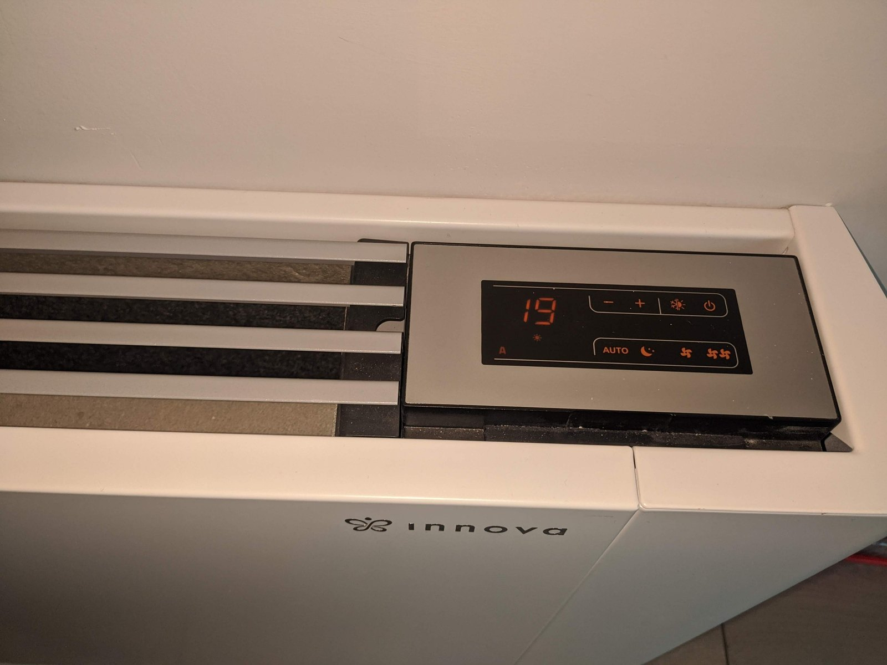
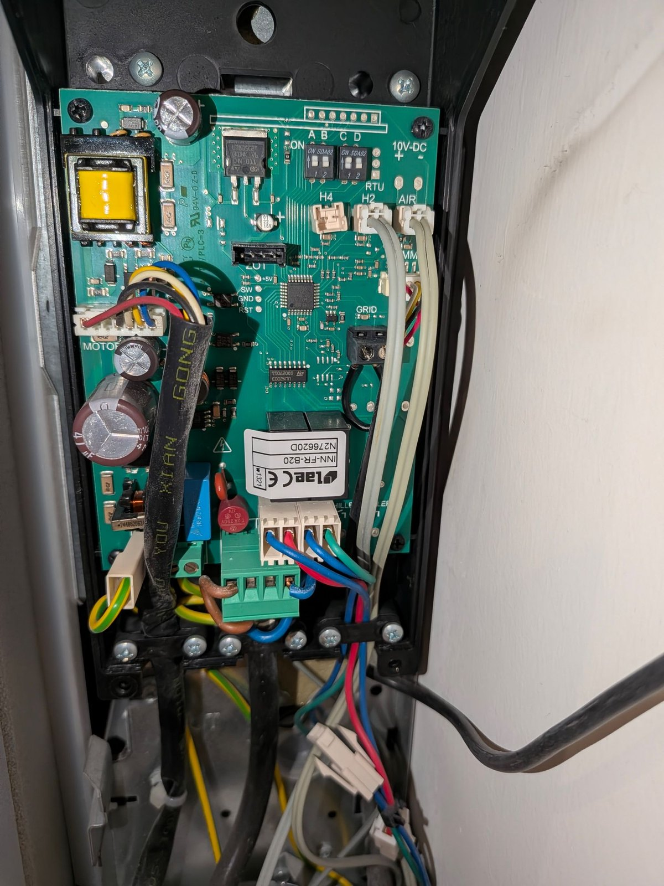
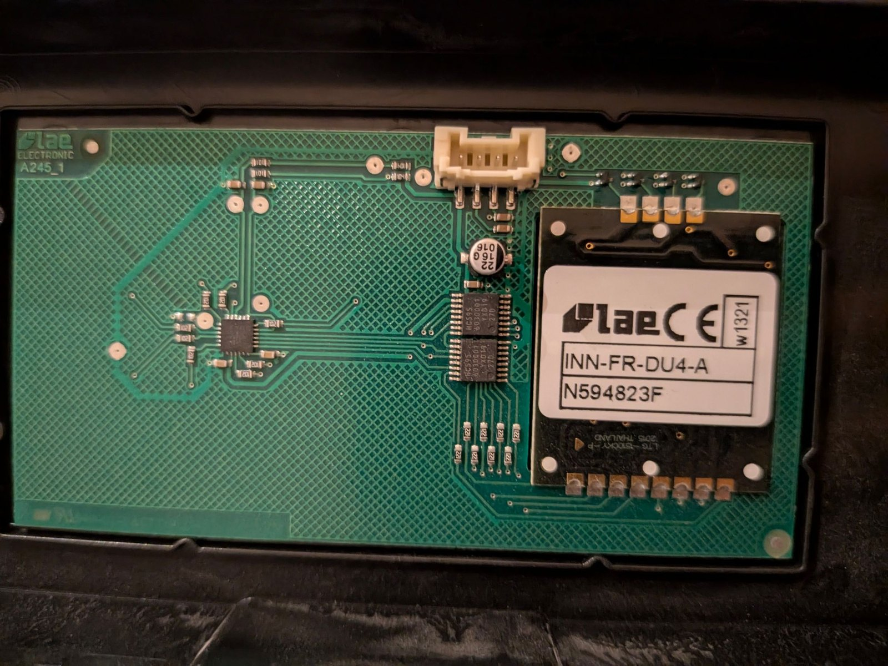
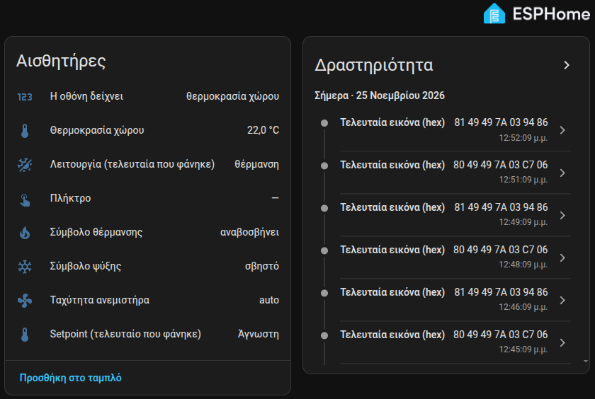
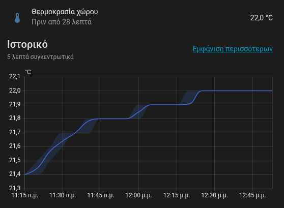

# Innova fan coil with E4T643 on-board control → ESPHome / Home Assistant

Reverse-engineering the **COMM** link between the main board and the touch display of Innova fan coils
that have **no Modbus terminals**, so that they can be read — and eventually controlled — from
Home Assistant with an ESP32 and a handful of passive parts.

> **Status — milestone 2 reached on 25 November 2026: reading works and the key dictionary is complete.**
> An ESP32 running ESPHome decodes the line and publishes room temperature, fan speed, the
> heating/cooling symbols and every key touch to Home Assistant. All eight keys are now known, along with
> what the board sends while the display is off and what "automatic changeover" looks like. The second
> signal wire (yellow) was captured during every key and carries none of them.
> **Writing (control) has not been attempted yet.** Nothing has ever been transmitted to the board.

This is a work log published while the work is still going on. It is updated at every milestone.
It is not affiliated with or endorsed by Innova.

> ⚠️ **Use at your own risk.** No warranty; you alone are responsible for your appliance's warranty, for any
> damage, and for the safety of people and property. Read the [disclaimer](#disclaimer--read-this-before-you-do-anything) first.

---

## The goal

Some Innova fan coils (AirLeaf family) ship with the on-board **Smart Touch control E4T643**. Unlike the
units with the ESE645/EDA649 or ECA644 controls, these have **no RS485 / Modbus connection** that an
installer can reach: the terminal block is simply not on the board.

| | |
|---|---|
| On-board control | **E4T643** (sold as E4T643II) — 4 fixed fan speeds, thermostat, capacitive touch keys |
| Main board label | `LAE · INN-FR-B20 · N276620D` |
| Touch display | `INN-FR-DU4-A` |
| Link between them | 4-wire cable on the connector marked **`COMM`** |



*The panel. Top row: `−`, `+`, mode (heat/cool), on/off. Bottom row: fan speed auto, night, low, high. Two
digits, and here the heating symbol below them.*

| | |
|---|---|
|  |  |
| *Main board `INN-FR-B20 · N276620D`. The `COMM` connector is on the right edge, half hidden behind the grey probe cables. There is no RS485 terminal block.* | *The touch display from behind: `INN-FR-DU4-A`, with its 4-pin connector for the COMM cable.* |

What we want, in one sentence: **one source of truth, two views.** Home Assistant sets and shows the
state; the physical touch panel keeps working; and the panel shows whatever was set from Home Assistant,
not a state of its own.

And we want to get there **in a way anyone can repeat**: by sitting on the COMM cable between board and
display with an ESP32, a cable and a few resistors — no soldering on the fan coil's board, no change to
its firmware.

## What works today (read only)

`esphome/fancoil.yaml` listens to one wire and gives Home Assistant:

| Entity | What it is | Limits |
|---|---|---|
| Room temperature | the value the board sends to the display, with one decimal | the display itself only shows whole degrees |
| Setpoint (last shown) | the setpoint | only known after someone touches a key: the board sends it for 20 s, then goes back to room temperature |
| Fan speed | auto / night / low / high | |
| Heating symbol, Cooling symbol | off / on / blinking | blinking = the unit wants to run but the water is not hot (or cold) enough |
| Mode (last shown) | heating / cooling | when the demand is satisfied both symbols are off and the frame does not say which mode is selected. Automatic changeover (both symbols lit) is not named yet |
| Display shows | room temperature / setpoint | |
| Key | which key is being touched right now | all 8 tails are known; this build names 7 and reports on/off as `unknown 0010000100000000` |
| Yellow bursts per second | activity on the yellow wire, mean over the last minute | optional wire; about 104 at rest, 280–400 while the fan motor runs (one unit, one evening) |
| Memory recording | state of the on-board recorder (button "Record to memory") | both wires with millisecond timestamps; about 22 s, or about 4 s once the fan starts |
| diagnostics | frames per second, unparsed bursts, line alive, last frame in hex | while the display is off its frames are counted as unparsed and the entities keep their last values |

The firmware only listens. The input pin it uses cannot drive a line.



*The device page in Home Assistant, 25 November 2026. The unit this was taken from runs a build with Greek
labels; the firmware in this repository is the same decoder with English names. From the top: display shows
room temperature · room temperature 22.0 °C · mode heating · key none · heating symbol **blinking** · cooling
symbol off · fan speed auto · setpoint unknown (nobody had touched a key since boot). The heat source was
off at the time, so the unit was waiting for hot water — hence the blinking symbol. On the right, the last
frame in hex, alternating between two images as the symbol blinks.*



*Room temperature as decoded from the line over 90 minutes, in steps of 0.1 °C. The display on the unit
itself shows whole degrees.*

Checks behind this claim:

- The decoder is plain C++ (`esphome/fancoil_decode.h`). The same file is compiled on a PC and run over
  the captures in `captures/`: **75,215 frames, zero differences** against the reference parser in Python.
  You can repeat that with `python3 tools/test_decoder.py captures/*.log.gz`.
- On the ESP32 it keeps up with the line: 31.4 frames per second, no rejected bursts in the first minutes.
- What it published matched what the person standing at the unit reported, key by key, for a session of
  23 key touches (see `captures/README.md`).
- The tail of the eighth key (on/off) was predicted in writing before it was captured, and came out as
  predicted: `0010 0001 0000 0000`.

Not yet checked: behaviour over many hours, and more than one physical unit. Everything here comes from
**one fan coil**.

## How the link works, briefly

The white wire carries one frame 31 times a second. It is **not** a UART.

```
[pre-pulse 0/2/3 ticks][sync 01010101][ 56 data bits ][ tail ~35 ticks ]
                                        board → display  carries the key being touched
1 tick = 15.89 µs
```

- The 56 bits are a picture of the display: three 7-segment digits, four fan-speed indicators, a heating
  and a cooling symbol, and a flag saying whether the digits are room temperature or setpoint.
- A key touch shows up in the **tail**, before the data bits react. Each of the eight keys has its own
  tail. That tail is what we will try to reproduce in order to "press keys" from Home Assistant.
- Some keys act only when held: mode after 1.56 s (heat ↔ cool) and after 10.0 s (automatic changeover on or
  off), on/off after 1.55 s. A bridge will have to hold a tail for hundreds of frames, not just a few.
- The **yellow** wire does not take part: its activity is the same with and without a key. It gets about
  fifteen times busier while the fan motor runs, which makes it look like coupled noise, not data.

Full details, evidence and open questions: **[docs/PROTOCOL.md](docs/PROTOCOL.md)**.

## Roadmap

| | Milestone | State |
|---|---|---|
| 1 | Read the line with ESPHome into Home Assistant | ✅ 25 Nov 2026 |
| 2 | Complete the key dictionary (the on/off key, the long press of the mode key, the frame while the display is off) | ✅ 25 Nov 2026 — the bits of the display-off frame are inferred, not measured |
| 2b | Firmware catches up: display off, automatic changeover, the on/off key by name, bit 29 | open — software only |
| 3 | Prove that the board accepts a key tail sent by the ESP32 | open — **the big unknown** |
| 4 | Bridge: ESP32 between board and display, both keep working | open |
| 5 | A proper `climate` entity in Home Assistant | open |
| 6 | Repeat on more units | open |

If milestone 3 fails, the fallback is the microcontroller's UART (the unit shows a Modbus address item in
its service menu, but the RS485 parts are not fitted). That route needs soldering, which is exactly what
this project tries to avoid.

## Repository layout

| Path | What |
|---|---|
| `esphome/fancoil.yaml`, `fancoil_decode.h` | the read-only firmware, with raw logging of either wire and a recorder for both |
| `esphome/raw_capture.yaml` | firmware that only logs raw pulse durations |
| `tools/` | Python tools that read those logs: frame parser, timeline, key dictionary, per-touch timing, symbol timeline, memory-recording reader, decoder test |
| `captures/` | the raw captures everything here is derived from |
| `docs/PROTOCOL.md` | what is known about the link, with the evidence for each claim |
| `docs/HARDWARE.md` | wiring of the read-only tap, wire colours, safety |
| `docs/JOURNEY.md` | how we got here, including two weeks of a wrong model and what overturned it |

## Try it

You need an ESP32 dev board, two resistors and access to the COMM cable.
Read **[docs/HARDWARE.md](docs/HARDWARE.md)** first: the line is 5 V logic, and on this cable the
**red wire is ground and the black wire is +5 V**.

```bash
cd esphome
cp secrets.yaml.example secrets.yaml      # then edit it
esphome run fancoil.yaml
```

Without any hardware you can still explore the captures:

```bash
python3 tools/timeline.py captures/2026-11-25_keys_part2.log.gz 08:46:00
python3 tools/presses.py  captures/2026-11-25_keys_part*.log.gz
python3 tools/symbols.py  captures/2026-11-25_keys_part2.log.gz
python3 tools/rec.py      captures/2026-11-25_recordings_keys.log.gz --frames   # all 8 keys, white and yellow together
python3 tools/test_decoder.py captures/*.log.gz
```

## How you can help

- **Do you have the same control (E4T643) or the same board?** A raw capture from a second unit would
  tell us whether the frame is identical across units and firmware versions. `esphome/raw_capture.yaml`
  produces it; please open an issue.
- **Do you recognise the frame format** — sync `01010101`, 56 bits, a reply tail on the same wire, a
  16-bit linear check field that is not a plain CRC? It may be a known display-driver or vendor protocol.
- **Do you know what the panel shows right after it is switched on?** One bit of the frame (bit 29) flips when
  the unit is switched on with its on/off key and flips back at the first setpoint change. We do not know
  which element of the display it is.
- **A different Innova control without Modbus terminals?** The approach should carry over; the bit map
  probably will not.

## Disclaimer — read this before you do anything

**Everything in this repository is used entirely at your own risk.**

This is an independent, unofficial hobby project. It is not affiliated with, authorised by or endorsed by
Innova. Product and model names are used only to identify the equipment the notes refer to.

- **No warranty of any kind.** The documents, firmware, tools and captures are provided "as is". Nothing
  here is guaranteed to be correct, complete, or applicable to your unit. All of it comes from **one**
  fan coil; other hardware or firmware revisions may behave differently, including wire colours and pinout.
- **Your appliance's warranty.** Opening the unit, connecting anything to its internal wiring, or changing
  how it is controlled may void the manufacturer's or the installer's warranty. The authors and
  contributors accept no responsibility for that.
- **Damage.** To the maximum extent permitted by law, the authors and contributors are not liable for any
  damage or loss arising from the use or misuse of anything here — to the fan coil or its electronics, to
  other equipment, to the heating or cooling system, or to the building and its contents (including water,
  condensation, frost or overheating damage), nor for any consequential cost.
- **Safety of persons and property.** A fan coil contains mains voltage, a moving fan and hot or cold
  water. Work on it only if you are competent to do so, with the power disconnected, and in line with the
  electrical regulations where you live. If in doubt, use a licensed professional. The authors and
  contributors are not liable for injury, electric shock, fire or any other harm.
- **Not a safety device.** An ESP32, a WiFi network and a home-automation server can all fail. Do not rely
  on anything here for frost protection, overheating protection or any function whose failure could harm
  people or property.
- **You are responsible for checking what you do.** Before connecting anything, verify it yourself on your
  own unit: voltages, wire colours, pin order, and whether what you are about to do is suitable, safe,
  lawful and compatible with your warranty.

So far the project has only listened to the line. When it starts transmitting, the documents will say
exactly what was tried and what happened — and the same disclaimer will apply, more so.

## License

MIT — see [LICENSE](LICENSE). The Innova manuals referred to in the documents are not included here.
