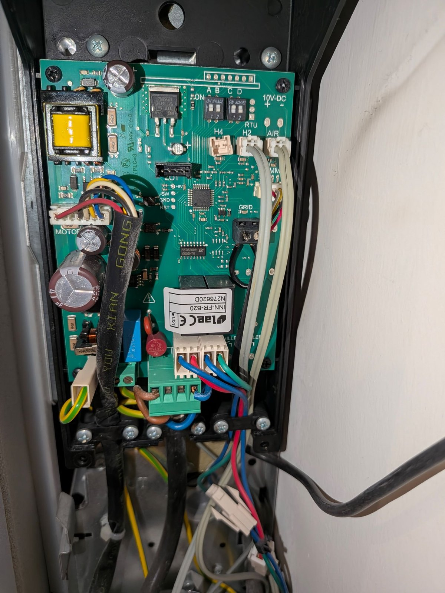
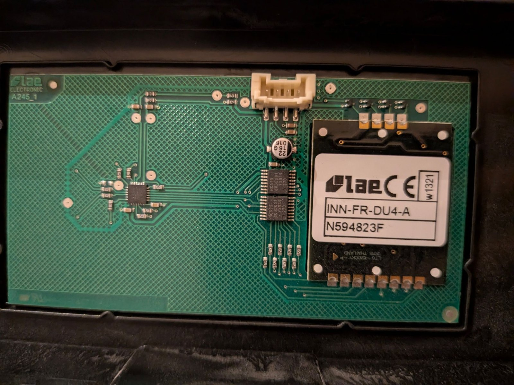
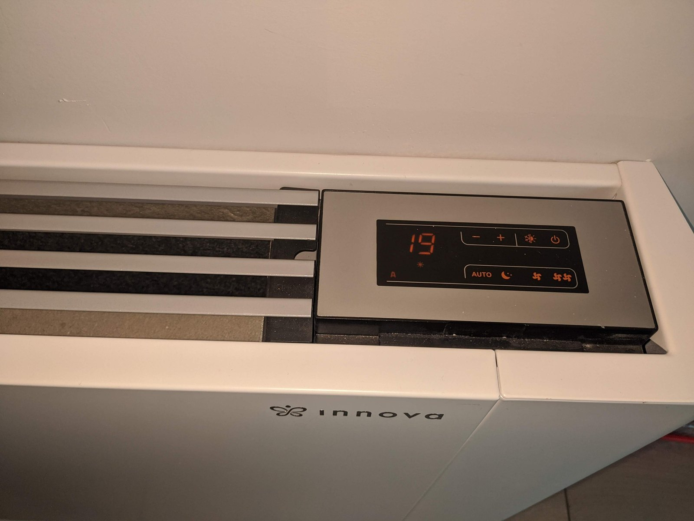
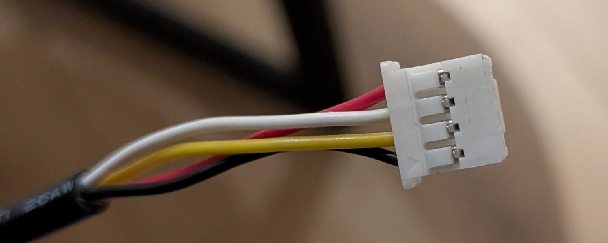

# Hardware — the read-only tap

What is described here is what milestone 1 was reached with: an ESP32 **listening in parallel** on the
cable between the fan coil's main board and its touch display. Nothing is cut, nothing on the board is
soldered, and the ESP32 cannot drive the line.

## Before you touch anything

> **You do this at your own risk.** The [disclaimer in the README](../README.md#disclaimer--read-this-before-you-do-anything)
> applies to everything on this page: no warranty, no liability for damage, injury or a voided appliance
> warranty, and you are responsible for verifying every step on your own unit.

- **Switch the fan coil off at the mains before opening it**, and before plugging or unplugging any
  connector. There is 230 V inside.
- **Never probe a live connector with bare wire.** The contacts of the COMM connector are about 2 mm
  apart. During this project a strand once bridged two neighbours; the display went dark until the unit
  was power-cycled. Nothing was damaged, but that was luck.
- **ESP32 pins do not tolerate 5 V.** The line is 5 V logic. Never connect it straight to a pin; see "The tap"
  for what was used here and what would be cleaner.
- **Do not power the ESP32 from the COMM cable.** Use its own USB supply. The +5 V on that cable feeds the
  board logic and the display, and an ESP32 with WiFi draws peaks of several hundred milliamps.

## What it looks like



*The main board, `INN-FR-B20 · N276620D`, in the electrical box at the side of the unit. Visible labels:
`COMM` (right edge, behind the grey probe cables — the 4-wire cable to the display leaves from there),
`AIR`, `H2`, `H4`, `GRID`, `MOTOR`, the DIP switches `A B` / `C D`, an unpopulated `RTU` footprint,
unpopulated `10V-DC + −` pads, and the `ZOT` header with its `+5V` `SW` `GND` `RST` pads. Mains wiring is at the
bottom. **There is 230 V on this board.***



*The touch display from behind, `INN-FR-DU4-A`. The white 4-pin connector at the top is the other end of the
COMM cable. Two `HC595` shift registers drive the LED module (under the label); a third IC handles the rest.*



*The panel from the front.*

## The cable

A 4-wire cable runs from the board connector marked `COMM` to the display. Voltages against the red
wire, measured twice with a multimeter:

| wire | voltage | role | goes to |
|---|---|---|---|
| **red** | 0 V | **ground** | ESP32 `GND` |
| **black** | +5.00 V | **+5 V** | not connected |
| **white** | +4.86 V, idles high | **data** | 10 kΩ in series → `GPIO34` |
| **yellow** | +0.12 V, idles low | carries no keys; busy while the fan motor runs (see [PROTOCOL.md](PROTOCOL.md) §10) | optional: its own 10 kΩ in series → `GPIO35` |



*The plug at the end of the COMM cable: red, white, yellow, black.*

> **Red is ground and black is +5 V on this cable — the opposite of what the colours suggest.**
> Taking black for ground cost this project about two weeks of meaningless captures. Check with a
> multimeter on your own unit before connecting anything: colours and pin order may differ.

## The tap

```
 COMM cable (board ↔ display, left connected)
     red   ─────────────────────────────── GND   (ESP32)
     white ────[ 10 kΩ ]────────────────── GPIO34
```

> **Correction, 26 November 2026.** Until today this page showed a 1 kΩ / 1.5 kΩ divider and said the line
> "tolerated" its 2.5 kΩ load. That divider was a plan that was never built. What has actually been on the
> unit since 22 November, and what every capture in this repository was taken with, is **one 10 kΩ resistor
> in series** per wire. The owner confirmed it for the white wire; the yellow wire is the same according to
> the notes of 22 November.

- **This is a bench shortcut, not a recommendation.** With 5 V on the line the pin sits above 3.3 V, and the
  resistor limits the current into the pin's input protection to roughly 0.15 mA (a calculation, not a
  measurement). That is outside what the ESP32 datasheet guarantees. It has worked here since 22 November
  with no visible harm.
- **The cleaner way is a divider**, for example 10 kΩ from the wire to the pin and 15 kΩ from the pin to
  ground (3.0 V at the pin). **Not tried in this project.** It would change the edge timing slightly, so
  captures taken that way may differ a little from the ones here.
- The 10 kΩ and the capacitance of the pin and wiring slow the edges (estimated at about 2 µs, not
  measured). At 15.89 µs per tick that did not hurt the white wire. For the narrow spikes of the yellow
  wire it means the durations in the documents are what the pin saw, not what is on the cable.
- The tap loads the line very lightly.
- **The yellow wire is optional.** Reading the unit needs only red and white. In this project yellow goes
  through a second 10 kΩ series resistor to `GPIO35` (also input-only), to observe it; the firmware's only use
  for it is the experimental "Fan running" guess. If you leave it out, remove what the header of
  `fancoil.yaml` lists under "the yellow wire is optional".
- GPIO34 is an input-only pin on the classic ESP32, with no internal pull resistors — so this ESP32
  physically cannot drive the line.
- The ESP32 measures pulse durations with its RMT peripheral (1 µs resolution). One pulse on this line
  is 15.89 µs, so there is plenty of margin.

Parts: an ESP32 dev board (`esp32dev`), a 10 kΩ resistor (two with the yellow wire), some wire. The cable ends in a
4-pin plug of the JST PH family. On the display board the pin pitch is **about 2.0 mm** — estimated from the
photo above, using the 0.65 mm pin pitch of the shift registers next to it as the scale (2.0–2.1 mm); it
has not been measured with a caliper, and the board-side connector has not been measured at all.
Wire order across the plug: red, white, yellow, black.

How you get onto the wires is up to you and your connector: an adapter cable is the clean way, and it is
what the next phase will use. In this project the tap was made once and then left in place while the
unit was closed again.

## Firmware

- `esphome/fancoil.yaml` — decodes the line and publishes to Home Assistant.
- `esphome/raw_capture.yaml` — only logs raw pulse durations; use it first on a unit nobody has looked at.

Both expect a `secrets.yaml` next to them (see `secrets.yaml.example`). That file is git-ignored on purpose.

## What a healthy tap looks like

- `Frames per second` ≈ **31**.
- `Unparsed bursts per minute` = 0, or very close.
- `Room temperature` agrees with the display (the display rounds to whole degrees).
- Touch a key: `Key` names it, and `Setpoint (last shown)` gets a value.
- If yellow is connected: `Yellow bursts per second` near 100 with the fan stopped (bursts every 10 ms, twice
  the 50 Hz mains frequency here), and several times that while the fan runs. `Fan running (experimental)`
  is derived from the same wire; compare it with what you hear before trusting it.
- Hold the on/off key until the display goes dark: `Unit on` should turn off and `Display shows` should read
  `off`. (On the unit this was developed on, that has so far only been checked on a PC against recordings.)

If you get bursts but no frames, check the ground first (red, not black), then whether your unit's frame
differs — in that case a raw capture is exactly what this project would like to see.

## Next phase — planned, NOT tested

To find out whether the board accepts a key sent by the ESP32, the plan is to take the **display's place**
on the COMM connector, keep reading through the same series resistor, and pull the white wire **low** through a
transistor and a 1 kΩ series resistor (so that, if the board actively holds the line high, the current
stays below 5 mA and the line simply does not move). The ESP32 would never drive the line high.
The yellow wire will not be needed for this: it was captured during all eight keys and showed nothing.

This is a plan. It will be documented here, with what happened, when it has been tried.
